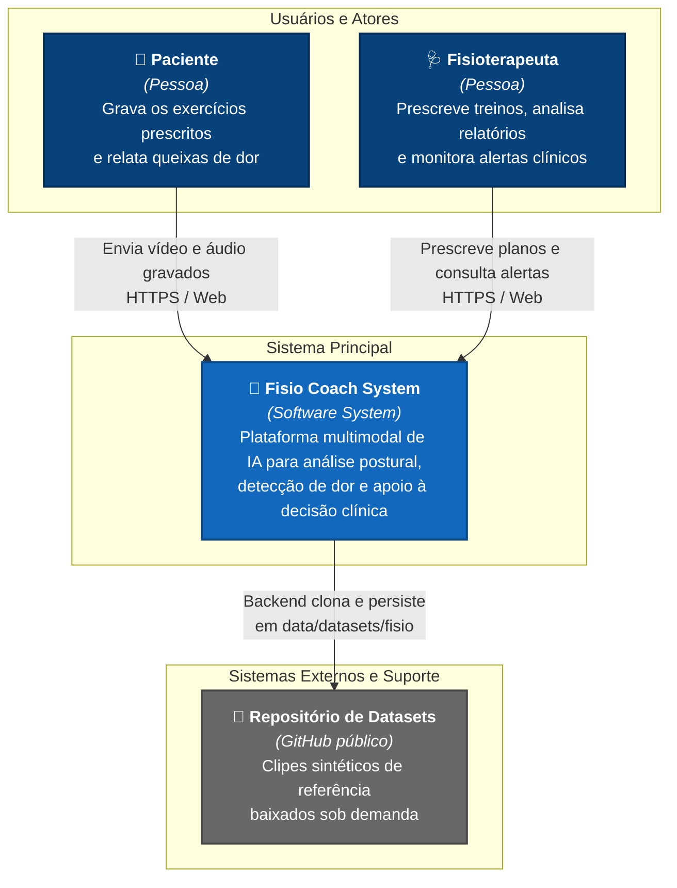
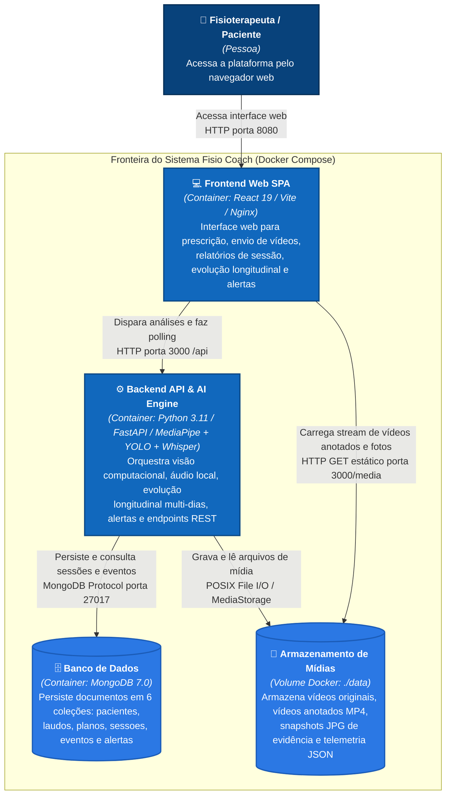
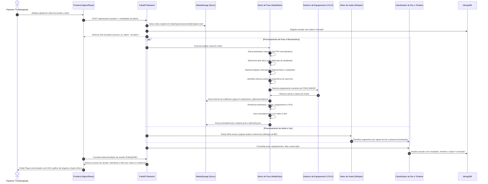
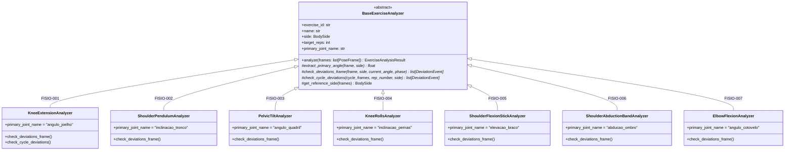

# Arquitetura do Sistema – Fisio Coach

**Tech Challenge · Fase 4 · Pós-Tech IA para Devs (FIAP)**  
**Versão:** 1.2 · **Data:** Novembro de 2026  
**Status:** Implementado (Issues #1 a #7 concluídas)

---

## 1. Visão Geral e Contexto de Negócio

O **Fisio Coach** é uma plataforma multimodal orientada por Inteligência Artificial projetada para auxiliar fisioterapeutas no monitoramento remoto e acompanhamento de sessões de exercícios de reabilitação motora.

O sistema analisa sessões gravadas em vídeo (contendo trilhas visuais e de áudio) para:
1. **Rastrear postura e biomecânica:** Extrair landmarks corporais, calcular ângulos articulares em tempo real, segmentar repetições válidas/inválidas e identificar desvios posturais específicos do exercício prescrito;
2. **Analisar fala relacionada à dor:** Extrair o áudio, transcrever localmente em pt-BR com Faster-Whisper e classificar segmentos por regras determinísticas de domínio;
3. **Verificar equipamentos:** Nos exercícios FISIO-006 e FISIO-007, detectar faixa elástica e halter com YOLO e apresentar o resultado no vídeo e no relatório;
4. **Fusão Multimodal e Alinhamento Clínico:** Correlacionar repetições, desvios e segmentos de fala classificados em uma linha do tempo unificada, confrontando o desempenho do paciente com a prescrição e o laudo médico;
5. **Geração de Evidências e Laudos Individuais:** Renderizar vídeos anotados com Head-Up Display (HUD) responsivo e gerar relatórios executivos por sessão com decomposição por série ($N$ séries $\times$ $M$ repetições) e snapshots comprobatórios dos desvios;
6. **Evolução Longitudinal Multi-Dias e Painel de Alertas Clínicos:** Acompanhar a jornada do paciente ao longo de múltiplos dias de tratamento (`dias_tratamento`, com suporte a exercícios diferentes por dia via `dias_prescritos`), avaliando a progressão de **Amplitude Articular (°)**, **Consistência Biomecânica (%)** e **Nível de Dor (0–10)** e gerando alertas automáticos priorizados por severidade (`■ Crítico`, `▲ Atenção`, `● Adequado`).

---

## 2. Diagramas de Arquitetura C4

### 2.1 C4 Nível 1 – Diagrama de Contexto

O diagrama abaixo ilustra o contexto do sistema, os usuários (fisioterapeuta e paciente) e as fronteiras do sistema Fisio Coach.



---

### 2.2 C4 Nível 2 – Diagrama de Containers

O sistema é modular e conteinerizado via Docker Compose, permitindo execução integral em ambiente local com suporte a aceleração em CPU:



---

### 2.3 C4 Nível 3 – Diagrama de Componentes do Backend

Detalhamento da arquitetura interna do container Backend (`backend/src/`):

```mermaid
flowchart TB
    subgraph "API Layer (FastAPI Controllers)"
        RouterSessions["Sessions Router<br/>/api/sessoes (POST multipart, POST JSON, GET, PATCH)"]
        RouterPatients["Patients, Plans & Evolution Router<br/>/api/pacientes (Pacientes, Laudos, Planos e Evolução)"]
        RouterAlerts["Alerts Router<br/>/api/alertas (GET, PATCH)"]
    end

    subgraph "Config & Infrastructure"
        MediaStorage["MediaStorage<br/>(Resolução segura e isolamento de caminhos)"]
        DBConnection["MongoDB Client<br/>(PyMongo / Motor)"]
        Repos["Repositories Layer<br/>Session, Event, Patient, Plan, MedicalReport & Alert"]
    end

    subgraph "Pose Engine (Vision & Biomechanics)"
        Processor["VideoPoseProcessor<br/>(Orquestrador do Pipeline de Vídeo)"]
        LandmarkExtractor["LandmarkExtractor<br/>(MediaPipe Pose, Sampler, Normalizer)"]
        Registry["ExerciseRegistry<br/>(Catálogo de Analisadores)"]
        BaseAnalyzer["BaseExerciseAnalyzer<br/>(Template Method: Fases, Ângulos, Repetições)"]
        Analyzers["7 Analisadores Especializados<br/>(FISIO-001 a FISIO-007)"]
        Geometry["Geometry Utilities<br/>(Ângulos 2D, Distâncias, Inclinações)"]
        RepetitionDetector["RepetitionDetector<br/>(Histerese, Interpolação, Suavização)"]
        HudRenderer["HudRenderer<br/>(Pillow + TrueType, Responsivo, UTF-8)"]
        ObjectDetector["ObjectDetector<br/>(YOLO CPU-only, FISIO-006/007)"]
        AudioTranscription["AudioTranscription<br/>(Faster-Whisper local, pt-BR)"]
        FFmpegTranscoder["FFmpeg Transcoder<br/>(H.264 / yuv420p / +faststart para Web)"]
    end

    subgraph "Persistence Sinks (Padrão Strategy)"
        ResultSink["ResultSink (Interface)"]
        FileSink["FileResultSink<br/>(analysis.json, telemetry.json)"]
        MongoSink["MongoResultSink<br/>(Classificação de Risco, sessoes, eventos, alertas)"]
        CompSink["CompositeResultSink<br/>(Despacho combinado disco + banco)"]
    end

    subgraph "Clinical Audio, Text & Longitudinal Evolution Engine"
        PainTextExtractor["PainTextExtractor<br/>(Normalização + regras clínicas)"]
        MultimodalFusion["PainTimeline<br/>(Segmentos de fala e eventos)"]
        ClinicalExtractor["ClinicalExtractor<br/>(Extração determinística de laudos pt-BR)"]
        EvolutionService["EvolutionService<br/>(Amplitude, Consistência, Dor 0-10, Séries N×M e Alertas)"]
    end

    RouterSessions --> MediaStorage
    RouterSessions --> Processor
    RouterSessions --> Repos
    RouterSessions --> EvolutionService
    RouterPatients --> Repos
    RouterPatients --> ClinicalExtractor
    RouterPatients --> EvolutionService
    RouterAlerts --> Repos
    Repos --> DBConnection
    Processor --> LandmarkExtractor
    Processor --> Registry
    Registry --> Analyzers
    Analyzers -.->|herda de| BaseAnalyzer
    BaseAnalyzer --> Geometry
    BaseAnalyzer --> RepetitionDetector
    Processor --> HudRenderer
    Processor --> ObjectDetector
    Processor --> AudioTranscription
    AudioTranscription --> PainTextExtractor
    PainTextExtractor --> MultimodalFusion
    Processor --> FFmpegTranscoder
    Processor --> MediaStorage
    Processor --> ResultSink
    FileSink -.->|implementa| ResultSink
    MongoSink -.->|implementa| ResultSink
    CompSink -.->|implementa| ResultSink
    MongoSink --> Repos
    MongoSink --> EvolutionService
    FileSink --> MediaStorage

    classDef controller fill:#1168bd,stroke:#0b4884,color:#ffffff,stroke-width:1.5px;
    classDef engine fill:#2a75c7,stroke:#1a5aa3,color:#ffffff,stroke-width:1.5px;
    classDef infra fill:#2b78e4,stroke:#1b5cb8,color:#ffffff,stroke-width:1.5px;
    classDef sink fill:#438dd5,stroke:#2063a8,color:#ffffff,stroke-width:1.5px;
    classDef planned fill:#f0f0f0,stroke:#9e9e9e,color:#424242,stroke-dasharray: 4 4;

    class RouterSessions,RouterPatients,RouterAlerts controller;
    class Processor,LandmarkExtractor,Registry,BaseAnalyzer,Analyzers,Geometry,RepetitionDetector,HudRenderer,ObjectDetector,AudioTranscription,PainTextExtractor,MultimodalFusion,ClinicalExtractor,EvolutionService,FFmpegTranscoder engine;
    class MediaStorage,DBConnection,Repos infra;
    class ResultSink,FileSink,MongoSink,CompSink sink;
```



---

## 3. Pipeline de Processamento Multimodal

O diagrama de sequência a seguir descreve o fluxo ponta a ponta desde o envio do vídeo até a disponibilização do laudo consolidado:



---

## 4. Arquitetura do Motor de Visão (Pose Engine)

O motor de visão foi desenvolvido com foco em alta precisão biomecânica, desacoplamento e suporte a execução nativa em CPU.

### 4.1 Padrão Strategy para os Analisadores de Exercício

A classe base `BaseExerciseAnalyzer` fornece os algoritmos comuns de processamento de séries temporais:
- **Interpolação de gaps:** Preenchimento linear de frames onde landmarks sofreram oclusão momentânea;
- **Suavização por média móvel:** Janela temporal configurável para atenuar tremores e ruídos de detecção de alta frequência;
- **Detecção por histerese:** Transição estável entre fases do movimento (`repouso` $\rightarrow$ `concentrica` $\rightarrow$ `pico` $\rightarrow$ `excentrica` $\rightarrow$ `repouso`), evitando contagens falsas geradas por oscilações no ápice do movimento;
- **Auto-seleção de lado (`AUTO`):** Para exercícios unilaterais, o sistema avalia simultaneamente o hemicorpo direito e esquerdo, selecionando o lado ativo pela visibilidade combinada e amplitude de movimento detectada.



### 4.2 Tabela de Cobertura dos 7 Exercícios do Dataset Sintético

| Código | Exercício | Lado Avaliado | Articulação Primária | Desvios Monitorados |
|---|---|---|---|---|
| **FISIO-001** | Extensão de joelho sentado | Ativo (`AUTO`/dir/esq) | Ângulo do Joelho ($180^\circ \rightarrow 90^\circ$) | `amplitude_reduzida`, `inclinacao_tronco`, `movimento_muito_rapido` |
| **FISIO-002** | Pêndulo de ombro de Codman | Ativo (`AUTO`/dir/esq) | Inclinação do Tronco e Ângulo do Cotovelo | `postura_ereta_inadequada`, `cotovelo_flexionado`, `braco_estatico` |
| **FISIO-003** | Inclinação pélvica deitado | Bilateral (`BOTH`) | Ângulo do Quadril e Joelhos | `pernas_estendidas_inadequadas`, `amplitude_insuficiente` |
| **FISIO-004** | Rotação de joelhos deitado | Bilateral (`BOTH`) | Ângulo do Fêmur vs Vertical | `espirro_lombar_compensatorio`, `amplitude_assimetrica` |
| **FISIO-005** | Flexão de ombro com bastão | Bilateral (`BOTH`) | Elevação do Braço vs Tronco | `assimetria_bracos`, `compensacao_lombar_hiperlordose` |
| **FISIO-006** | Abdução de ombro com elástico | Ativo (`AUTO`/dir/esq) | Abdução do Braço vs Tronco | `inclinacao_tronco`, `faixa_fora_de_quadro`, `amplitude_reduzida` |
| **FISIO-007** | Flexão de cotovelo com halter | Ativo (`AUTO`/dir/esq) | Ângulo do Cotovelo ($160^\circ \rightarrow 50^\circ$) | `balanco_tronco`, `amplitude_incompleta`, `cotovelo_afastado_corpo` |

---

## 5. Arquitetura de Dados e Armazenamento

A arquitetura estabelece uma separação estrita entre **arquivos binários de mídia pesada** (armazenados em disco com controle rígido de path traversal) e **estruturas de metadados relacionais/documentais** (persistidas no MongoDB):

```
RAIZ_DO_REPOSITORIO/
├── data/                                 # [MEDIA_ROOT] Isolado fora do Git
│   ├── inputs/
│   │   └── sessions/
│   │       └── {session_id}/
│   │           └── original.mp4         # Vídeo bruto enviado pelo paciente
│   └── outputs/
│       └── {run_id}/
│           └── pose/
│               ├── annotated.mp4        # Vídeo renderizado com esqueleto e HUD
│               ├── analysis.json        # Pose, desvios, dor e equipamento
│               ├── telemetry.json       # Série temporal frame a frame dos ângulos
│               └── evidence/
│                   ├── rep01_pico.jpg   # Snapshot da repetição
│                   └── rep01_desvio.jpg # Snapshot comprobatório do desvio
```

### Coleções do MongoDB (`fiap-pos-ia-db`)

#### Implementadas:
1. **`sessoes`:** Documento central da sessão (`SessionDocument`). Contém `session_id`, `paciente_id`, `slot_id` (vínculo com o slot da prescrição, ex.: `SLOT-1`), `dia_tratamento` (`1..D`), `series_prescritas` ($N$), `repeticoes_por_serie` ($M$), `serie_index`, `exercicio_id`, `case_id`, `side_evaluated`, `lgpd_aceite` (registro auditável do aceite do Termo de Consentimento LGPD para imagem e voz), `original_filename`, `file_size_bytes`, `status` (`enviado`, `processando`, `concluido`, `erro`), `etapa`, `compliance_score`, `target_repetitions`, repetições válidas/inválidas, total de desvios, métricas longitudinais (`amplitude_maxima`, `amplitude_media`, `consistencia_score`, `dor_score_0_10`, `dor_percentual_tempo`, `series_breakdown`), `avaliado_fisioterapeuta`, `risk_classification` (`verde`, `atencao`, `critico`), `justificativas` explicáveis em português e referências relativas para os arquivos sob `data/` (`video_path`, `annotated_video_path`, `analysis_path`, `telemetry_path`).
2. **`eventos`:** Coleção desacoplada de eventos da sessão (`EventDocument`). Armazena cada repetição (`tipo: "repeticao"`, com pico angular, duração e validade), cada desvio detectado (`tipo: "desvio"`, com severidade, frame inicial/final e caminho do snapshot em `evidence/`) e cada fala relacionada à dor (`tipo: "fala_dor"`, com timestamps, nível e texto transcrito).
3. **`pacientes`:** Cadastro do paciente (`PatientDocument` — `paciente_id`, `nome` fictício, `idade`, `observacoes` e flag `synthetic=True` para conformidade LGPD), com seed inicial automático (`PAC-001` a `PAC-004`).
4. **`laudos`:** Diagnóstico médico ortopédico estruturado (`MedicalReportDocument` — `laudo_id`, `paciente_id`, `texto_original`, `regiao`, `lesao`, `movimentos_restritos`, `limite_amplitude_max`, `extraido_automaticamente` e `revisado_profissional`).
5. **`planos`:** Prescrição do fisioterapeuta (`PlanDocument` — `plano_id`, `paciente_id`, `dias_tratamento`, `dor_maxima_aceitavel` na escala 0–10, `amplitude_esperada_texto`/`min`/`max`, `avaliado_evolucao`, `observacoes_avaliacao_final` e lista de exercícios `PrescribedExerciseItem` com `slot_id`, `exercicio_id`, `dia_tratamento`, `dias_prescritos` para cronogramas diários personalizados, `series`, `repeticoes`, `lado`, `equipamento` e `instrucoes`).
6. **`alertas`:** Notificações clínicas direcionadas ao painel do fisioterapeuta (`AlertDocument` — `alerta_id`, `paciente_id`, `session_id`, `slot_id`, `dia_tratamento`, `severidade` em `critico`/`atencao`/`verde`, `tipo`, `titulo`, `motivo`, `evidencia_resumo` e `estado` em `novo`/`lido`/`tratado`).

---

## 6. Requisitos Não Funcionais e Decisões de Engenharia

| Requisito | Solução Arquitetural | Impacto / Benefício |
|---|---|---|
| **Execução em CPU (sem GPU)** | MediaPipe Pose, YOLO e Faster-Whisper configurados para CPU; PyTorch/Torchvision CPU-only | Permite rodar o pipeline completo em computador convencional ou container Docker sem CUDA, GPU dedicada ou custos de instâncias de GPU na nuvem. |
| **Detecção de equipamentos** | YOLO especializado para `faixa_elastica` e `halter`, ativado apenas nos exercícios que exigem esses objetos | Mantém a análise de pose e fornece status por frame e percentuais no relatório sem custo nos demais exercícios. |
| **Transcrição e dor verbal** | Faster-Whisper local, preparação de áudio, prompt pt-BR e regras determinísticas de domínio | Evita custo e dependência de cloud e mantém segmentos temporais explicáveis para a timeline. |
| **Extração de laudos e prescrições** | Extrator determinístico local em pt-BR (`clinical_extractor.py`) com revisão humana (*human-in-the-loop*) na UI | Identifica região, lesão e restrições angulares instantaneamente sem serviços externos, permitindo conferência e edição pelo fisioterapeuta. |
| **Evolução Longitudinal e Alertas** | Agregador determinístico multi-dias (`evolution_service.py`), decomposição automática em séries (`Série 1..N`), agendamento por dia (`dias_prescritos`) e coleção `alertas` | Consolida a evolução clínica de Amplitude (°), Consistência (0–100%) e Dor (0–10) ao longo dos dias e sessões de tratamento com linguagem ética de apoio à decisão. |
| **Integridade de Caracteres no Vídeo** | Renderização do HUD via Pillow (`ImageDraw` com fonte TrueType UTF-8) | Exibe acentuação correta em português (`ã`, `á`, `ç`) e notações científicas (`°`, `≥`), eliminando interrogações (`?`) típicas do OpenCV Hershey. |
| **HUD Responsivo e Dinâmico** | Cálculo proporcional baseado na largura e altura do frame | Garante que vídeos verticais (típicos de gravações de smartphone) e horizontais exibam caixas de alerta perfeitamente enquadradas sem cortes de texto. |
| **Streaming e Compatibilidade Web** | Transcodificação pós-renderização via FFmpeg em H.264 (`yuv420p` + `+faststart`) e Nginx com 250MB | Permite playback nativo instantâneo no frontend React via tag `<video>` em qualquer browser moderno sem erros de codec, suportando vídeos de alta resolução. |
| **Segurança e Privacidade (LGPD)** | Dados em `data/` isolados no `.gitignore` e caminhos validados por regex | Mídias sensíveis de pacientes não sobem ao Git; sanitização impede ataques de *Path Traversal* (`../`). |
| **Portabilidade Host/Container** | `MediaStorage` com fallback dinâmico absoluto | O sistema resolve o caminho correto tanto executado localmente via CLI quanto encapsulado no container Docker com volume mapeado. |
