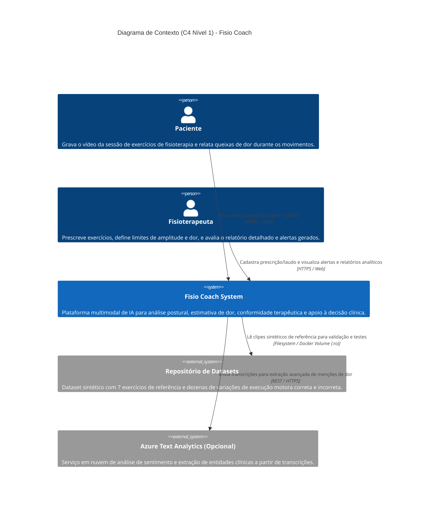
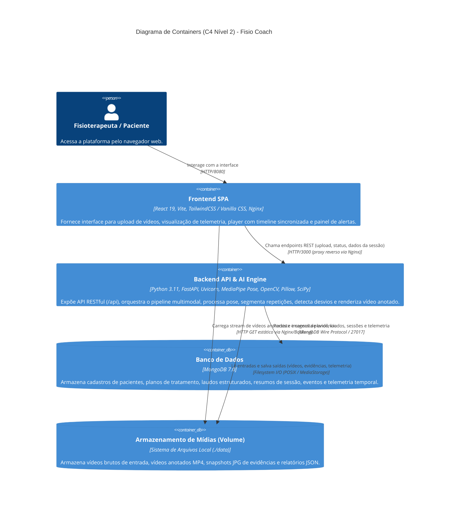
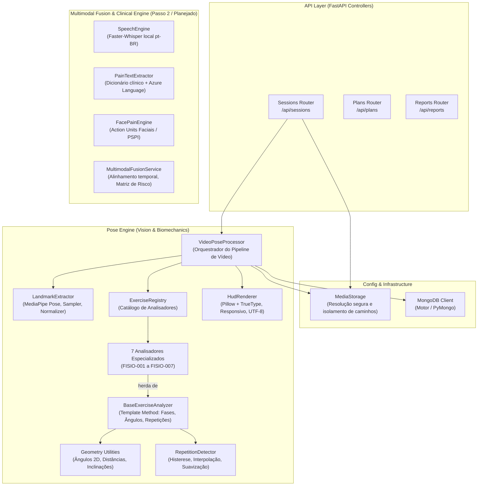
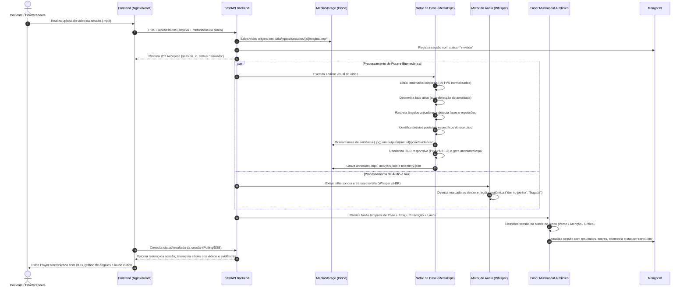
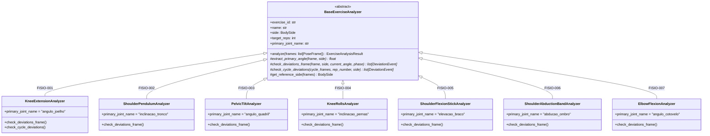

# Arquitetura do Sistema – Fisio Coach

**Tech Challenge · Fase 4 · Pós-Tech IA para Devs (FIAP)**  
**Versão:** 1.0 · **Data:** Outubro de 2026  
**Status:** Aprovado e em implementação

---

## 1. Visão Geral e Contexto de Negócio

O **Fisio Coach** é uma plataforma multimodal orientada por Inteligência Artificial projetada para auxiliar fisioterapeutas no monitoramento remoto e acompanhamento de sessões de exercícios de reabilitação motora.

O sistema analisa sessões gravadas em vídeo (contendo trilhas visuais e de áudio) para:
1. **Rastrear postura e biomecânica:** Extrair landmarks corporais, calcular ângulos articulares em tempo real, segmentar repetições válidas/inválidas e identificar desvios posturais específicos do exercício prescrito;
2. **Estimar dor e fadiga:** Capturar queixas verbais de dor (transcrição de áudio em pt-BR e PLN clínico) e analisar microexpressões faciais de desconforto;
3. **Fusão Multimodal e Alinhamento Clínico:** Correlacionar repetições, desvios e picos de dor em uma linha do tempo unificada, confrontando o desempenho do paciente com o laudo da lesão e a prescrição do fisioterapeuta;
4. **Geração de Evidências e Laudos:** Renderizar vídeos anotados com Head-Up Display (HUD) responsivo e gerar relatórios executivos com snapshots comprobatórios dos desvios.

---

## 2. Diagramas de Arquitetura C4

### 2.1 C4 Nível 1 – Diagrama de Contexto

O diagrama abaixo ilustra o contexto do sistema, os usuários (fisioterapeuta e paciente) e as fronteiras do sistema Fisio Coach.



---

### 2.2 C4 Nível 2 – Diagrama de Containers

O sistema é modular e conteinerizado via Docker Compose, permitindo execução integral em ambiente local com suporte a aceleração em CPU:



---

### 2.3 C4 Nível 3 – Diagrama de Componentes do Backend

Detalhamento da arquitetura interna do container Backend (`backend/src/`):



---

## 3. Pipeline de Processamento Multimodal

O diagrama de sequência a seguir descreve o fluxo ponta a ponta desde o envio do vídeo até a disponibilização do laudo consolidado:



---

## 4. Arquitetura do Motor de Visão (Pose Engine)

O motor de visão foi desenvolvido com foco em alta precisão biomecânica, desacoplamento e suporte a execução nativa em CPU.

### 4.1 Padrão Strategy para os Analisadores de Exercício

A classe base `BaseExerciseAnalyzer` fornece os algoritmos comuns de processamento de séries temporais:
- **Interpolação de gaps:** Preenchimento linear de frames onde landmarks sofreram oclusão momentânea;
- **Suavização por média móvel:** Janela temporal configurável para atenuar tremores e ruídos de detecção de alta frequência;
- **Detecção por histerese:** Transição estável entre fases do movimento (`repouso` $\rightarrow$ `concentrica` $\rightarrow$ `pico` $\rightarrow$ `excentrica` $\rightarrow$ `repouso`), evitando contagens falsas geradas por oscilações no ápice do movimento;
- **Auto-seleção de lado (`AUTO`):** Para exercícios unilaterais, o sistema avalia simultaneamente o hemicorpo direito e esquerdo, selecionando o lado ativo pela visibilidade combinada e amplitude de movimento detectada.



### 4.2 Tabela de Cobertura dos 7 Exercícios do Dataset Sintético

| Código | Exercício | Lado Avaliado | Articulação Primária | Desvios Monitorados |
|---|---|---|---|---|
| **FISIO-001** | Extensão de joelho sentado | Ativo (`AUTO`/dir/esq) | Ângulo do Joelho ($180^\circ \rightarrow 90^\circ$) | `amplitude_reduzida`, `inclinacao_tronco`, `movimento_muito_rapido` |
| **FISIO-002** | Pêndulo de ombro de Codman | Ativo (`AUTO`/dir/esq) | Inclinação do Tronco e Ângulo do Cotovelo | `postura_ereta_inadequada`, `cotovelo_flexionado`, `braco_estatico` |
| **FISIO-003** | Inclinação pélvica deitado | Bilateral (`BOTH`) | Ângulo do Quadril e Joelhos | `pernas_estendidas_inadequadas`, `amplitude_insuficiente` |
| **FISIO-004** | Rotação de joelhos deitado | Bilateral (`BOTH`) | Ângulo do Fêmur vs Vertical | `espirro_lombar_compensatorio`, `amplitude_assimetrica` |
| **FISIO-005** | Flexão de ombro com bastão | Bilateral (`BOTH`) | Elevação do Braço vs Tronco | `assimetria_bracos`, `compensacao_lombar_hiperlordose` |
| **FISIO-006** | Abdução de ombro com elástico | Ativo (`AUTO`/dir/esq) | Abdução do Braço vs Tronco | `inclinacao_tronco`, `faixa_fora_de_quadro`, `amplitude_reduzida` |
| **FISIO-007** | Flexão de cotovelo com halter | Ativo (`AUTO`/dir/esq) | Ângulo do Cotovelo ($160^\circ \rightarrow 50^\circ$) | `balanco_tronco`, `amplitude_incompleta`, `cotovelo_afastado_corpo` |

---

## 5. Arquitetura de Dados e Armazenamento

A arquitetura estabelece uma separação estrita entre **arquivos binários de mídia pesada** (armazenados em disco com controle rígido de path traversal) e **estruturas de metadados relacionais/documentais** (persistidas no MongoDB):

```
RAIZ_DO_REPOSITORIO/
├── data/                                 # [MEDIA_ROOT] Isolado fora do Git
│   ├── inputs/
│   │   └── sessions/
│   │       └── {session_id}/
│   │           └── original.mp4         # Vídeo bruto enviado pelo paciente
│   └── outputs/
│       └── {run_id}/
│           └── pose/
│               ├── annotated.mp4        # Vídeo renderizado com esqueleto e HUD
│               ├── analysis.json        # Resumo analítico, repetições e desvios
│               ├── telemetry.json       # Série temporal frame a frame dos ângulos
│               └── evidence/
│                   ├── rep01_pico.jpg   # Snapshot da repetição
│                   └── rep01_desvio.jpg # Snapshot comprobatório do desvio
```

### Coleções do MongoDB (`fiap-pos-ia-db`)

1. **`pacientes`:** Cadastro do paciente, histórico clínico e lesões diagnosticadas.
2. **`planos`:** Prescrição do fisioterapeuta (exercício, repetições alvo, faixa de ângulo esperada, limite de dor tolerável).
3. **`laudos`:** Diagnóstico médico ortopédico estruturado com restrições de movimento e amplitudes máximas permitidas.
4. **`sessoes`:** Registro da execução com timestamps, status do processamento, classificação de risco (`verde`, `atencao`, `critico`), caminhos relativos das mídias em `data/` e métricas consolidadas.
5. **`telemetria`:** Registro das séries temporais de ângulos articulares para geração dos gráficos de evolução temporal.
6. **`alertas`:** Notificações direcionadas ao painel do fisioterapeuta sobre desvios críticos ou relatos de dor acima do limiar.

---

## 6. Requisitos Não Funcionais e Decisões de Engenharia

| Requisito | Solução Arquitetural | Impacto / Benefício |
|---|---|---|
| **Execução em CPU (sem GPU)** | Adoção do MediaPipe Pose com modelo BlazePose leve | Permite rodar o pipeline completo em qualquer computador convencional ou container Docker sem custos de instâncias com GPU na nuvem. |
| **Integridade de Caracteres no Vídeo** | Renderização do HUD via Pillow (`ImageDraw` com fonte TrueType UTF-8) | Exibe acentuação correta em português (`ã`, `á`, `ç`) e notações científicas (`°`, `≥`), eliminando interrogações (`?`) típicas do OpenCV Hershey. |
| **HUD Responsivo e Dinâmico** | Cálculo proporcional baseado na largura e altura do frame | Garante que vídeos verticais (típicos de gravações de smartphone) e horizontais exibam caixas de alerta perfeitamente enquadradas sem cortes de texto. |
| **Segurança e Privacidade (LGPD)** | Dados em `data/` isolados no `.gitignore` e caminhos validados por regex | Mídias sensíveis de pacientes não sobem ao Git; sanitização impede ataques de *Path Traversal* (`../`). |
| **Portabilidade Host/Container** | `MediaStorage` com fallback dinâmico absoluto | O sistema resolve o caminho correto tanto executado localmente via CLI quanto encapsulado no container Docker com volume mapeado. |
