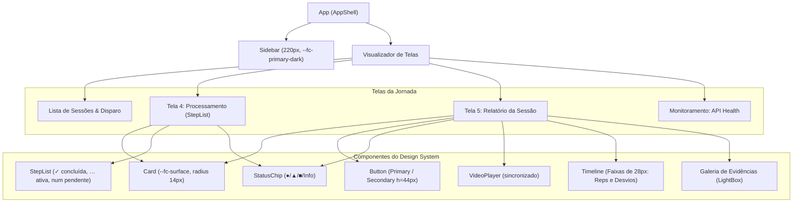

# Plano de Implementação – Passo 3: Relatório de Análise Individual do Vídeo (Issue #6)
### Alinhado ao Design System Oficial (`docs/design/DESIGN.md` e `tokens.css`)

> **Contexto:** Atendimento à Issue [#6](https://github.com/vagner-nascimento/fiap-pos-ia-para-devs-fase4-tech-challenge/issues/6) (*"Criar estrutura frontend/backend para análise dos vídeos e geração e apresentação de relatório individual dos mesmos"*), conectando o motor de visão (Passo 1) e a persistência MongoDB (Passo 2) a uma interface web fiel aos princípios, tokens e componentes do **Design System do Fisio Coach**.

---

## 1. Princípios de Design Adotados (`docs/design/DESIGN.md`)

1. **Evidência junto do veredito:** Toda classificação de desvio e repetição exibe a evidência visual correspondente (snapshot `.jpg` de `outputs/{id}/pose/evidence/` ou salto direto no vídeo anotado).
2. **Apoio à decisão, nunca diagnóstico:** Inclusão mandatória do aviso *"Apoio à decisão, não diagnóstico."* no cabeçalho e rodapé do relatório.
3. **Estado nunca só por cor:** Todos os chips e badges clínicos usam **símbolo + texto + cor**:
   - `● Verde` (`--fc-ok-bg` / `--fc-ok-fg`): sem desvios críticos.
   - `▲ Atenção` (`--fc-warn-bg` / `--fc-warn-fg`): desvios posturais moderados ou amplitude reduzida.
   - `■ Crítico` (`--fc-crit-bg` / `--fc-crit-fg`): múltiplos desvios ou alto risco clínico.
4. **Fonte Única de Verdade de Estilos:**
   - Importação e uso estrito de `docs/design/tokens.css` via variáveis `var(--fc-*)`. Sem valores hexadecimais soltos no CSS.
   - Tipografia oficial: **Plus Jakarta Sans** (pesos 400, 500, 700, 800).
5. **Acessibilidade e Layout Responsivo:** Alvos de clique $\ge 44\text{ px}$ (`--fc-control-h`), contraste mínimo de 4.5:1, `aria-label` nos controles de mídia e layout desktop-first (base 1280px) com coluna única no mobile.

---

## 2. Decisões de Design e Revisão do Usuário

> [!IMPORTANT]
> **Integração dos Tokens:** O arquivo `docs/design/tokens.css` será copiado/importado para `frontend/src/tokens.css` e importado no topo de `frontend/src/styles.css` e `main.jsx`, servindo como a fundação de todos os componentes React.

> [!NOTE]
> **Branch de Trabalho:** Continuaremos no branch isolado `feature/passo-3-relatorio-individual-video` para implementação e testes antes do merge para a `main`.

---

## 3. Arquitetura de Componentes React (Baseada em `docs/design/`)



---

## 4. Mudanças Propostas

### 4.1 Infraestrutura e Roteamento de Mídias

#### [MODIFY] [frontend/nginx.conf](file:///home/luizbaroni/Projetos/fiap/fiap-pos-ia-para-devs-fase4-tech-challenge/frontend/nginx.conf)
- Adicionar bloco `location /media/` com `proxy_pass http://backend:3000;` para viabilizar o streaming do vídeo anotado (`.mp4`) e frames de evidência (`.jpg`) no container Docker (porta 8080).

#### [MODIFY] [frontend/vite.config.js](file:///home/luizbaroni/Projetos/fiap/fiap-pos-ia-para-devs-fase4-tech-challenge/frontend/vite.config.js)
- Adicionar proxy para `/media` apontando para `http://localhost:3000` em ambiente de desenvolvimento local.

---

### 4.2 Backend API

#### [MODIFY] [backend/src/rest/routers/sessions.py](file:///home/luizbaroni/Projetos/fiap/fiap-pos-ia-para-devs-fase4-tech-challenge/backend/src/rest/routers/sessions.py)
- **`GET /api/sessoes/clips-referencia`**: Varre `DATASET_ROOT` e retorna os clipes de teste sintéticos disponíveis de forma catalogada (`case_id`, `filename`, `descricao`).
- **`GET /api/sessoes/{id}/relatorio`**: Retorna objeto estruturado consolidado do relatório da sessão conforme rota especificada na Tabela 3 de `docs/design/DESIGN.md`, pronto para consumo da interface e impressão.

#### [MODIFY] [backend/tests/unit/pose/test_sessions_api.py](file:///home/luizbaroni/Projetos/fiap/fiap-pos-ia-para-devs-fase4-tech-challenge/backend/tests/unit/pose/test_sessions_api.py)
- Adicionar testes automatizados cobrindo os novos endpoints.

---

### 4.3 Frontend Web (Design System)

#### [NEW] `frontend/src/tokens.css`
- Importa `https://fonts.googleapis.com/css2?family=Plus+Jakarta+Sans:wght@400;500;700;800&display=swap`.
- Define formalmente todas as variáveis `--fc-*` especificadas em `docs/design/tokens.css`.

#### [NEW] `frontend/src/api/sessions.js`
- Cliente REST com tratamento de erros: `listSessions`, `getSession`, `getSessionEvents`, `getSessionReport`, `createSessionUpload`, `createSessionReference`, `listReferenceClips`.

#### [NEW] Componentes Reutilizáveis do Design System (`frontend/src/components/ds/`):
- **`Button.jsx`**: Suporta variantes `primary` e `secondary` (`s`), altura 44px, raio 10px, peso 700.
- **`Card.jsx`**: Superfície branca (`--fc-surface`), borda `--fc-border`, raio 14px, padding 20px.
- **`StatusChip.jsx`**: Renderiza pílulas com símbolo explícito:
  - `ok`: `● Verde`
  - `warn`: `▲ Atenção`
  - `crit`: `■ Crítico`
  - `info`: `ℹ Informação`
- **`StepList.jsx`**: Implementa o fluxo de etapas da **Tela 4 (Processamento)**:
  - Círculo de status: `✓` verde para concluída, `…` teal pulsante para ativa, número cinza para pendente.
- **`Timeline.jsx`**: Implementa as faixas temporais da **Tela 5 (Relatório)**:
  - Altura 28px (`--fc-track-bg`), blocos proporcionais com raio 4px.
  - Faixas dedicadas: *Repetições* (`--fc-track-rep`), *Desvios de Postura* (`--fc-track-desvio`), *Dor Facial* (`--fc-track-dor`), *Fala de Dor* (`--fc-track-fala`).
  - Sincronizada com o tempo atual do player. Clicar em um bloco posiciona o vídeo no frame exato.
- **`VideoPlayer.jsx`**: Player HTML5 responsivo com controles, carregando o stream de `/media/outputs/{id}/pose/annotated.mp4` e emitindo eventos de `timeupdate`.

#### [NEW] Telas Principais da Aplicação:
- **`frontend/src/components/ProcessingView.jsx` (Tela 4 do Mock):**
  - Exibe título, exercício avaliado, lista de etapas (`StepList`), barra de progresso visual de processamento e polling automático até `concluido` ou `erro`.
- **`frontend/src/components/SessionReportView.jsx` (Tela 5 do Mock):**
  - **Cabeçalho:** Nome do paciente, código do exercício, total de repetições e `StatusChip` de severidade.
  - **Grid Central:**
    - Coluna esquerda: `VideoPlayer` sobre o vídeo anotado com esqueleto + `Timeline` multicamadas (repetições e desvios) + transcrição/análise de dor.
    - Coluna direita: Cards de resumo clínico com métricas consolidadas, score de conformidade, comparação clínica (Plano / Laudo / Inconsistência) e justificativas médicas.
  - **Galeria de Evidências:** Cards com fotos dos desvios (`evidence/*.jpg`) com modal de ampliação (*lightbox*).
  - **Ações:** Botão "Baixar / Imprimir PDF" (com folha de estilos `@media print`) e aviso mandatório *"Apoio à decisão, não diagnóstico."*.
- **`frontend/src/components/SessionsListView.jsx`:**
  - Histórico de sessões do paciente com filtros, status e modal de disparo rápido (upload de MP4 ou seleção de clipe do dataset).

#### [MODIFY] [frontend/src/App.jsx](file:///home/luizbaroni/Projetos/fiap/fiap-pos-ia-para-devs-fase4-tech-challenge/frontend/src/App.jsx)
- Estrutura baseada em `AppShell`: Sidebar fixa 220px (`--fc-primary-dark`, texto `--fc-sidebar-text`), menu por perfil ("Fisioterapeuta"), roteamento simples entre Sessões, Processamento, Relatório da Sessão e API Health.

#### [MODIFY] [frontend/src/styles.css](file:///home/luizbaroni/Projetos/fiap/fiap-pos-ia-para-devs-fase4-tech-challenge/frontend/styles.css)
- Substituir regras genéricas por classes fiéis ao `docs/design/DESIGN.md`, utilizando estritamente variáveis de tokens (`var(--fc-*)`) e regras `@media print` para exportação limpa em PDF.

---

## 5. Plano de Verificação

### 5.1 Testes Automatizados
```bash
# 1. Backend: verificar novos endpoints e regressões
cd backend && uv run pytest tests/ -v

# 2. Frontend: validação do build de produção Vite
cd frontend && npm run build
```

### 5.2 Validação Visual e Funcional Ponta a Ponta
1. **Ambiente Docker Compose:**
   ```bash
   docker compose up -d --build
   ```
2. **Navegação e Design System:**
   - Acessar `http://localhost:8080`.
   - Verificar tipografia *Plus Jakarta Sans*, cores dos tokens e sidebar fixa de 220px.
3. **Fluxo da Tela 4 (Processamento):**
   - Disparar análise via clipe `FISIO-001-extensao-parcial.mp4`.
   - Acompanhar a transição de etapas na `StepList` (ícones `✓`, `…`, numerais).
4. **Fluxo da Tela 5 (Relatório da Sessão):**
   - Conferir badge `▲ Atenção` com símbolo triangular explícito.
   - Reproduzir o vídeo anotado no player e verificar a sincronia da barra da `Timeline`.
   - Clicar em um bloco de desvio na timeline e checar o salto no player.
   - Inspecionar a galeria de evidências e abrir foto em tamanho real.
   - Clicar em "Baixar PDF" / Imprimir e conferir a formatação impressa sem cortes.
