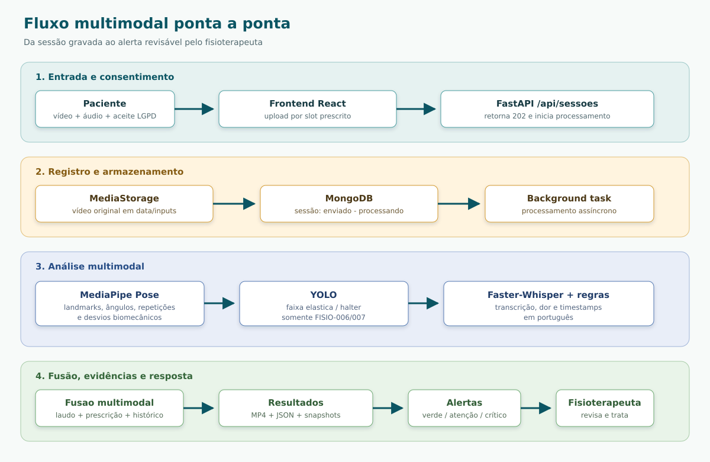

# Fisio Coach
## Relatorio Tecnico - Tech Challenge Fase 4

**Curso:** FIAP Pos-Tech IA para Devs  
**Projeto:** Fisio Coach  
**Versao do relatorio:** 1.0  
**Data:** novembro de 2026  
**Repositorio:** fiap-pos-ia-para-devs-fase4-tech-challenge

> Este documento descreve a implementacao existente no repositorio. Quando um resultado quantitativo de acuracia ou latencia nao esta medido por benchmark versionado, o texto identifica a evidência como funcional/estrutural, sem apresentar numeros estimados como se fossem metricas experimentais.

---

## Resumo executivo

O Fisio Coach e uma plataforma multimodal para apoio ao fisioterapeuta no acompanhamento remoto de sessoes de reabilitacao. A entrada principal e um video gravado pelo paciente, contendo imagem, movimento e, quando disponivel, a fala relacionada a dor. O sistema combina quatro fontes de informacao:

1. **Video:** landmarks corporais, angulos articulares, fases do movimento, repeticoes, desvios biomecanicos e equipamentos.
2. **Audio:** extracao da trilha, transcricao local em portugues e classificacao de relatos de dor/desconforto com timestamps.
3. **Texto clinico:** laudo e prescricao estruturados a partir de texto em portugues, com limites de movimento, dor aceitavel e exercicios prescritos.
4. **Historico:** comparacao de sessoes ao longo dos dias, produzindo indicadores de amplitude, consistencia e dor.

Os resultados sao persistidos em arquivos e MongoDB, apresentados em relatorios de sessao e evolucao, e convertidos em alertas com severidade `verde`, `atencao` ou `critico`. O frontend apresenta o video anotado, a linha do tempo de eventos, evidencias fotograficas e o painel de alertas.

A solucao atende diretamente ao nucleo de analise de video, audio, texto, anomalias e fusao multimodal. Ha uma diferenca importante em relacao ao enunciado: a implementacao atual usa Faster-Whisper local e um classificador deterministico de dominio, em vez de Azure Speech to Text e Azure Text Analytics. Essa decisao esta documentada nos ADRs e prioriza custo zero, reprodutibilidade e execucao local. A integracao Azure permanece como extensao planejada, e nao e apresentada neste relatorio como funcionalidade concluida.

---

## 1. Contexto, objetivo e escopo

O desafio da Fase 4 propoe integrar IA a processos medicos, analisando dados multimodais para identificar sinais precoces de risco e alertar a equipe. O recorte escolhido foi o acompanhamento de exercicios de fisioterapia, no qual o paciente grava uma sessao e o fisioterapeuta precisa verificar se o movimento foi executado conforme a prescricao.

### 1.1 Objetivo do produto

O objetivo do Fisio Coach e reduzir o trabalho manual de revisao de sessoes, oferecendo ao profissional:

- contagem automatica de repeticoes;
- verificacao de amplitude e fase do movimento;
- identificacao de compensacoes biomecanicas;
- verificacao de equipamento quando aplicavel;
- correlacao entre eventos do video e relatos de dor;
- comparacao longitudinal entre dias de tratamento;
- evidencias auditaveis para justificar cada alerta.

O sistema nao substitui avaliacao clinica. Ele produz sinais, medidas e evidencias para apoiar a decisao do fisioterapeuta.

### 1.2 Escopo implementado

O MVP suporta quatro exercicios:

| Codigo | Exercicio |
|---|---|
| FISIO-001 | Extensao de joelho sentado |
| FISIO-002 | Pendulo de ombro (Codman) |
| FISIO-006 | Abducao de ombro com elastico |
| FISIO-007 | Flexao de cotovelo com halter |

A aplicacao suporta cadastro de paciente, laudo, prescricao, upload por slot prescrito, processamento assincrono, relatorio individual, evolucao longitudinal e painel de alertas. O armazenamento de demonstracao usa dados sinteticos.

### 1.3 Fora do escopo atual

Nao fazem parte da implementacao atual:

- analise de cirurgias;
- sinais vitais como batimentos, pressao arterial e oxigenacao;
- diagnostico medico;
- treinamento de um modelo proprio de visao ou fala durante a execucao;
- integracao efetiva com Azure Cognitive Services;
- garantia clinica de acuracia sem validacao com dataset anotado e avaliacao profissional.

---

## 2. Aderencia aos entregaveis da Fase 4

O edital solicita repositorio Git, relatorio tecnico com fluxo multimodal, modelos aplicados e resultados/exemplos de anomalias, alem de video demonstrativo. Este arquivo e o relatorio tecnico do repositorio. O video de demonstracao sera entregue separadamente, conforme a orientacao do edital; o link nao fica no repositorio e, por isso, nao e incorporado a este documento.

| Entregavel ou requisito | Evidencia no projeto | Situacao |
|---|---|---|
| Repositorio com codigo-fonte | Backend FastAPI, frontend React/Vite, Docker Compose, testes e documentacao | Implementado |
| Fluxo multimodal | Pipeline de video, audio, texto clinico e evolucao | Implementado |
| Modelos de video | MediaPipe Pose, analisadores de exercicio e YOLO para equipamentos | Implementado |
| Modelos de audio | Faster-Whisper local e regras de classificacao de dor | Implementado com substituicao local |
| Resultados e exemplos de anomalias | Relatorios JSON, video anotado, telemetria, snapshots e alertas | Implementado |
| Alertas automaticos | Severidade e persistencia em `alertas`, painel web | Implementado |
| Azure Speech to Text | Nao ha cliente Azure no codigo atual | Nao implementado, justificativa na secao 9 |
| Azure Text Analytics | Nao ha cliente Azure no codigo atual | Nao implementado, justificativa na secao 9 |
| Video de ate 15 minutos | Sera entregue separadamente, fora do repositorio | Entrega externa ao repositorio |

---

## 3. Arquitetura da solucao

### 3.1 Componentes

A aplicacao e executada com Docker Compose em tres servicos principais:

- **Frontend:** React 19, Vite e Nginx, exposto na porta 8080.
- **Backend:** Python 3.11, FastAPI e motor de IA, exposto na porta 3000.
- **MongoDB:** MongoDB 7 para persistencia, exposto na porta 27017.

O diretorio `data` e montado como armazenamento persistente para videos originais, videos anotados, snapshots e arquivos JSON.

O backend separa as responsabilidades entre routers REST, services, motor de pose, motor de audio, repositorios, armazenamento de midia e sinks de resultado. O processamento pode gravar simultaneamente em disco e banco por meio do `CompositeResultSink`.

### 3.2 Fluxo ponta a ponta



A API retorna `202 Accepted` para o processamento assincrono. O frontend consulta o status e atualiza o progresso ate a conclusao ou erro.

### 3.3 Persistencia e rastreabilidade

As principais colecoes MongoDB sao:

- `pacientes`: dados cadastrais sinteticos;
- `laudos`: regiao, lesao, restricoes e limites angulares;
- `planos`: dias, exercicios, series, repeticoes, lado, equipamento e dor maxima;
- `sessoes`: status, metadados, metricas, consentimento e referencias de midia;
- `eventos`: repeticoes, desvios, evidencias e falas relacionadas a dor;
- `alertas`: severidade, justificativa, status e vinculo com paciente/sessao.

Cada execucao tambem pode produzir:

- `annotated.mp4`: video com esqueleto, HUD, eventos e equipamento;
- `analysis.json`: resumo executivo estruturado;
- `telemetry.json`: serie temporal de medidas;
- `evidence/*.jpg`: quadros que comprovam desvios.

---

## 4. Modelos e tecnicas aplicados

### 4.1 Video e postura

O `MediaPipe Pose` extrai 33 landmarks corporais. As coordenadas sao normalizadas e usadas para calcular angulos e distancias por geometria 2D. O pipeline identifica o lado ativo automaticamente quando o exercicio permite, considerando visibilidade e amplitude observada.

A deteccao de repeticoes usa uma maquina de estados com fases de repouso, movimento concentrico, pico e movimento excentrico. Interpolacao de gaps e suavizacao reduzem o impacto de oclusoes momentaneas e ruido. A histerese evita que oscilacoes proximas do limiar sejam contadas como repeticoes adicionais.

O padrao Strategy permite que cada exercicio implemente seus angulos primarios e suas regras de desvio sem duplicar o pipeline comum. Os quatro analisadores ativos ficam registrados em um catalogo de exercicios.

### 4.2 Objetos e equipamentos

O detector baseado em YOLO usa o modelo `best.pt` para reconhecer os equipamentos relevantes nos exercicios FISIO-006 e FISIO-007:

- `faixa_elastica`;
- `halter`.

O resultado e associado aos frames e agregado no relatorio. O HUD mostra a caixa e o status do equipamento; a ausencia ou baixa cobertura pode gerar um achado de execucao.

### 4.3 Audio e fala

A trilha de audio e extraida e convertida para mono, 16 kHz, com reducao de ruido e normalizacao. O `Faster-Whisper` realiza a transcricao local em portugues. O resultado preserva timestamps para a fusao temporal com repeticoes e desvios.

A classificacao de dor e deterministica e orientada ao dominio. As categorias sao:

- `pouca_ou_nenhuma_dor`;
- `desconforto`;
- `dor`;
- `muita_dor`.

As regras consideram termos e precedencia de negacao para reduzir classificacoes falsas em frases como “nao estou com dor”. O resultado nao e um modelo clinico de sentimento geral; e um classificador explicavel para relatos de dor e desconforto.

### 4.4 Texto clinico

O extrator clinico interpreta laudo e prescricao em portugues para obter campos estruturados, como regiao anatomica, lesao, movimentos restritos, limites angulares, dias de tratamento, exercicios, series, repeticoes e dor maxima aceitavel.

Esses dados funcionam como contexto para avaliar se uma sessao esta dentro da prescricao. A mesma medida biomecanica pode ser aceitavel para um paciente e gerar alerta para outro, dependendo do limite registrado.

### 4.5 Evolucao e anomalias

A avaliacao longitudinal organiza as sessoes por dia, exercicio, serie e repeticao. Os indicadores principais sao:

- **Amplitude articular:** medida em graus, comparada a faixa esperada;
- **Consistencia biomecanica:** escore de 0 a 100% derivado da regularidade das execucoes;
- **Dor:** escore de 0 a 10 obtido da prescricao e dos relatos classificados.

As regras de alerta combinam violacao de limite angular, compensacao, repeticao invalida, dor acima do limite e tendencia desfavoravel na evolucao. A situacao adequada e apresentada visualmente na cor verde; os estados de alerta sao `atencao` e `critico`, sempre com justificativa persistida para permitir revisao humana.

---

## 5. Exemplos de anomalias detectadas

Os exemplos abaixo representam os tipos de achado gerados pela implementacao e seus artefatos de evidencia. Eles descrevem o comportamento funcional e nao devem ser interpretados como estatistica de desempenho clinico.

### 5.1 Desvio de amplitude ou limite angular

Quando o angulo calculado ultrapassa o limite do laudo ou fica fora da faixa prescrita, o evento recebe referencia temporal, exercicio, repeticao e evidencia fotografica. O relatorio pode indicar a amplitude observada, o limite aplicavel e a recomendacao de revisao pelo fisioterapeuta.

**Evidencia produzida:** evento em `eventos`, registro em `analysis.json`, quadro em `evidence/*.jpg` e marcador no video anotado.

### 5.2 Compensacao postural

Os analisadores verificam regras especificas do exercicio, como inclinacao de tronco, assimetria, movimento de segmento nao desejado ou falha da fase esperada. O achado e vinculado ao ciclo ou frame em que ocorreu.

**Resposta do sistema:** a repeticao pode ser marcada como invalida, o motivo aparece na timeline e a severidade e recalculada para o resumo da sessao.

### 5.3 Dor relatada durante a execucao

Uma fala transcrita como “estou com muita dor” e associada ao timestamp do audio. O segmento passa a compor a timeline multimodal e pode elevar o risco quando supera a dor maxima definida na prescricao.

**Resposta do sistema:** o evento `fala_dor` e persistido, aparece junto ao player e pode alimentar alerta `atencao` ou `critico`, conforme a regra configurada.

### 5.4 Equipamento ausente ou inadequado

Nos exercicios com faixa elastica ou halter, o detector verifica a presenca do objeto. A cobertura temporal e o status sao agregados no relatorio. Um resultado inconsistente e uma evidencia para revisao da sessao, sem afirmar sozinho que o movimento foi clinicamente incorreto.

### 5.5 Piora longitudinal

Se a amplitude diminui, a consistencia cai ou a dor aumenta ao longo dos dias, o servico de evolucao registra a tendencia e gera alerta para o painel do fisioterapeuta. O alerta mantem a justificativa e a relacao com as sessoes que o originaram.

---

## 6. Interface e jornada do usuario

### 6.1 Paciente

1. Consulta a prescricao e os slots do dia.
2. Envia o video correspondente ao exercicio.
3. Confirma o consentimento LGPD da sessao.
4. Acompanha o processamento.
5. Consulta o resultado liberado pela aplicacao.

### 6.2 Fisioterapeuta

1. Cadastra paciente e laudo.
2. Registra ou revisa a prescricao estruturada.
3. Consulta sessoes e relatorios individuais.
4. Reproduz o video anotado com timeline sincronizada.
5. Inspeciona snapshots e metricas.
6. Consulta evolucao multi-dias.
7. Le, marca e trata alertas.

### 6.3 Privacidade e governanca

O upload exige aceite explicito de consentimento por sessao. A demonstracao utiliza dados sinteticos e mantem as midias separadas por identificador de execucao. O sistema foi desenhado como apoio a decisao, com justificativas e evidencias para revisao profissional, sem automatizar diagnostico.

---

## 7. Execucao e reproducibilidade

### 7.1 Execucao completa

Na raiz do repositorio:

```sh
sh start_app.sh
```

Ou diretamente:

```sh
docker compose -f docker-compose.yaml up -d --build
```

Acessos:

- Frontend: `http://localhost:8080`
- OpenAPI: `http://localhost:3000/docs`
- Health check: `http://localhost:3000/api/health`
- MongoDB: `mongodb://localhost:27017`

Para encerrar ou reiniciar:

```sh
sh stop_app.sh
sh restart_app.sh
```

### 7.2 Execucao do backend e testes

O backend requer Python `>=3.11,<3.13` e usa `uv` no fluxo documentado:

```sh
cd backend
uv sync
uv run pytest tests -v
```

A suite cobre transcricao, dataset, geometria, repeticoes, analisadores, processador de video, YOLO, HUD, armazenamento de midia, progresso, APIs de sessao, pacientes, evolucao e alertas. Os arquivos de configuracao do repositorio declaram 147 testes automatizados.

### 7.3 Execucao CLI de um video

```sh
uv run ./backend/src/cli/analyze_video.py \
  --video /caminho/para/video.mp4 \
  --case FISIO-001 \
  --side auto \
  --target-reps 5 \
  --run-id sessao_teste_01
```

Para cada caso, o resultado deve ser inspecionado junto com o video anotado, o JSON executivo, a telemetria e as evidencias. A interpretacao clinica continua sendo responsabilidade do profissional.

### 7.4 Frontend isolado

```sh
cd frontend
npm ci
npm run build
npm run dev
```

---

## 8. Validacao, resultados e limites da evidencia

### 8.1 Evidencias de implementacao

O repositorio contem:

- codigo dos quatro analisadores ativos (FISIO-001, FISIO-002, FISIO-006 e FISIO-007);
- testes unitarios e de integracao;
- diretorios de saida de sessoes com resultados de pose;
- documentacao de arquitetura e ADRs;
- endpoints HTTP documentados em `api.http`;
- componentes web para relatorio individual, evolucao e alertas.

Isso comprova a existencia do fluxo implementado e permite uma demonstracao reproduzivel. Nao substitui, porem, uma avaliacao de acuracia contra ground truth clinico.

### 8.2 Riscos conhecidos

- Camera, iluminacao, roupa e oclusao podem reduzir a qualidade dos landmarks.
- A classificacao por regras nao cobre todo o vocabulário de dor, fadiga ou dificuldade respiratoria.
- Whisper local depende da qualidade do audio e do modelo escolhido.
- YOLO depende do dominio representado no modelo `best.pt`.
- A execucao local em CPU pode aumentar o tempo de processamento.
- Dados sinteticos nao representam a variabilidade de pacientes reais.
- Alertas sao sinais de apoio e precisam de validacao profissional.

---

## 9. Lacunas em relacao ao edital e plano de evolucao

### 9.1 Justificativa para nao usar Azure nesta versao

O edital cita Azure Speech to Text e Azure Text Analytics. A equipe avaliou essa alternativa, mas decidiu nao depender de recursos Azure na versao demonstrativa por uma combinacao de restricoes de custo, infraestrutura, privacidade e reproducibilidade. Essa escolha esta registrada nos ADRs 0010 (Faster-Whisper), 0011 (deteccao de dor por transcricao) e 0012 (extracao de laudos e prescricoes).

#### Criterios da decisao

1. **Orcamento da demonstracao:** o projeto nao possui orcamento para servicos de nuvem. O uso de APIs gerenciadas introduziria custo recorrente por volume de audio, texto e chamadas, enquanto as alternativas locais nao possuem custo por requisicao.
2. **Reproducibilidade:** a entrega precisa ser executavel por avaliadores com `docker compose up`, sem criar conta, provisionar recurso, cadastrar endpoint ou configurar chave de API. Os modelos e regras locais permitem repetir a demonstracao com a mesma entrada e o mesmo contrato de dados.
3. **Execucao em CPU:** MediaPipe Pose, YOLO e Faster-Whisper foram configurados para CPU, com PyTorch/Torchvision CPU-only e Whisper em `int8`. Isso evita GPU dedicada, CUDA e custos de instancias de GPU na nuvem.
4. **Privacidade e LGPD:** audio, transcricoes, laudos e prescricoes permanecem no ambiente local. Assim, a demonstracao nao precisa enviar dados de saude a um provedor externo; o projeto ainda usa dados sinteticos e registra o consentimento por sessao.
5. **Explicabilidade:** a dor e extraida de segmentos transcritos com timestamps, normalizacao e regras de dominio, incluindo precedencia de negacao. O laudo usa extracao deterministica e revisao humana antes da persistencia. O profissional consegue ver o texto e revisar os campos, em vez de receber apenas uma classificacao opaca.
6. **Testabilidade:** os componentes locais sao determinísticos o suficiente para testes unitarios, sem flutuação causada por rede, indisponibilidade, limite de quota ou mudanca de modelo remoto durante a avaliacao.
7. **Complexidade operacional:** Azure exigiria credenciais, configuracao de recursos, observabilidade, tratamento de falhas de rede e controle de segredos. Remover essa dependencia manteve o backend portavel entre maquina local e container Docker.

#### Recursos locais escolhidos

| Necessidade | Recurso local | Motivo da escolha |
|---|---|---|
| Landmarks e postura | MediaPipe Pose | Roda em CPU, possui wheel Python, 33 landmarks e licenca permissiva; evita a dependencia de CUDA e a compilacao complexa do OpenPose (ADR 0001). |
| Equipamentos | YOLO com `best.pt` | Detecta apenas `faixa_elastica` e `halter` nos exercicios FISIO-006 e FISIO-007, em CPU, sem chamada externa (ADR 0009). |
| Transcricao | Faster-Whisper local | Mantem audio e timestamps no ambiente local, sem custo por requisicao, rede ou credenciais (ADR 0010). |
| Dor na fala | Regras deterministicas sobre a transcricao | E explicavel, reproduzivel e adequado ao vocabulario restrito da demonstracao; nao exige um classificador clinico ou NLP em nuvem (ADR 0011). |
| Laudo e prescricao | `clinical_extractor.py` + revisao humana | Extrai campos em portugues sem serviço pago e permite correcao pelo fisioterapeuta antes de salvar (ADR 0012). |
| Persistencia e execucao | MongoDB, Docker Compose e armazenamento em `data/` | Mantem a stack local, auditavel e reproduzivel, sem depender de banco ou armazenamento gerenciado. |

“Gratuito” neste contexto significa sem tarifa de servico por requisicao e baseado em componentes locais/open source ou em artefatos do proprio projeto. Isso nao elimina custos de hardware, energia, armazenamento ou manutencao, nem representa uma afirmacao de que todos os componentes possuem a mesma licenca.

#### Trade-offs aceitos

A decisao reduz escalabilidade e pode aumentar a latencia em CPU em comparacao com uma API cloud. O Whisper local tambem pode errar em ruido, sotaques e falas sobrepostas; as regras de dor nao compreendem toda nuance clinica; e o extrator de laudos cobre apenas o vocabulario mapeado. Por isso, os resultados sao apoio a decisao, nao diagnostico, e precisam de validacao com dados anotados e profissionais de saude antes de uso clinico.

### 9.2 Azure Cognitive Services como evolucao compativel

A decisao local nao fecha a porta para Azure. Para diversificar a cobertura dos requisitos em uma futura implantacao, pode-se criar portas de transcricao e analise de linguagem com duas implementacoes:

- adaptador local para desenvolvimento, testes e modo offline;
- adaptador Azure selecionado por configuracao para ambiente de demonstracao ou producao.

As credenciais devem permanecer em variaveis de ambiente e nunca no frontend ou no repositorio. O resultado dos dois adaptadores deve manter o mesmo contrato interno de segmentos, timestamps, texto e classificacao, permitindo trocar o provedor sem alterar o frontend nem a persistencia.

### 9.3 Sinais vitais

A arquitetura de anomalias poderia receber um modulo de series temporais para batimentos, pressao e oxigenacao, com janela, baseline individual e regras de ausencia/outlier. Esse modulo poderia compartilhar o contrato de alerta, mas permanecer separado do analisador biomecanico.

---

## 10. Conclusao

O Fisio Coach entrega uma implementacao funcional de acompanhamento multimodal para fisioterapia: processa video e audio, interpreta contexto textual, gera evidencias, persiste resultados e transforma anomalias em alertas revisaveis. A arquitetura separa API, services, motores de IA, persistencia e apresentacao, permitindo evolucao incremental.

O principal ponto de conformidade parcial e a camada de servicos Azure, substituida na versao atual por processamento local documentado. Essa limitacao esta explicitada para que o avaliador diferencie o que foi implementado do que permanece como evolucao. Dentro do recorte de fisioterapia e com dados sinteticos, o projeto oferece o fluxo tecnico necessario para demonstrar analise multimodal, deteccao de anomalias e apoio ao acompanhamento clinico.

---

## Referencias do repositorio

- `README.md`
- `docs/edital-tech-challenge-fase4.md`
- `docs/arquitetura/arquitetura-do-sistema.md`
- `docs/arquitetura/adrs/`
- `backend/src/services/pose/`
- `backend/src/services/audio_transcription.py`
- `backend/src/services/clinical_extractor.py`
- `backend/src/services/evolution_service.py`
- `backend/tests/`
- `frontend/src/`
- `docker-compose.yaml`
- `api.http`
