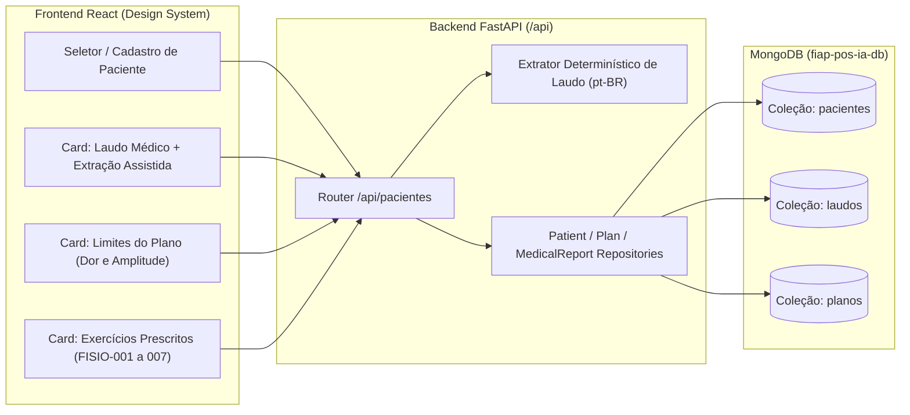

# Plano de Implementação — Issue #3: Inserção de Dados de Laudo e Prescrições (`[Médico/Fisioterapeuta]`)

> **Contexto:** Atendimento à Issue [#3](https://github.com/vagner-nascimento/fiap-pos-ia-para-devs-fase4-tech-challenge/issues/3) (*"[Médico/Fisioterapeuta] Inserção de dados de laudo e prescrições — Criação de estrutura frontend/backend para inserção de laudos e prescrições por paciente"*), implementando o **Passo 1 da Jornada Principal** (`docs/prd-fisio-coach-tech-challenge-fase4-v1_2.md`) e as **Telas 1 e 8** do Design System oficial (`docs/design/DESIGN.md` e Mock `01-Plano-Laudo.dc.html`).

---

## 1. Visão Geral e Escopo

Esta etapa estabelece a base cadastral e clínica do **Fisio Coach**, permitindo que o fisioterapeuta cadastre pacientes (dados sintéticos), insira o **laudo médico** em texto livre com extração assistida de restrições clínicas e configure o **plano de prescrição de exercícios** (séries, repetições, limite de dor e faixa de amplitude esperada).

Essa estrutura também prepara o terreno diretamente para:
- **Issue #4:** Busca de dados de laudo e prescrições pelo paciente;
- **Issue #5:** Geração dinâmica dos "slots" de upload de vídeos com base nos exercícios prescritos no plano do paciente.

---

## 2. Decisões Arquiteturais e de Design

> [!IMPORTANT]
> **Extração Estruturada do Laudo com Revisão Humana:** Conforme especificado no PRD v1.2 (Seção 4 e 6.3) e no `DESIGN.md` (Seção 4), ao digitar ou enviar o texto do laudo, o backend extrai automaticamente `regiao`, `lesao`, `movimentos_restritos` e `limite_amplitude_max` via regras determinísticas de domínio em pt-BR, mas permite que o fisioterapeuta edite/confirme esses campos na interface (`"Extraído automaticamente (confira):"`).

> [!TIP]
> **Catálogo de Exercícios Unificado:** Unificamos o catálogo para expor todos os **7 exercícios de referência (`FISIO-001` a `FISIO-007`)** do dataset sintético com seus respectivos equipamentos e lados padrão.

---

## 3. Mudanças Propostas por Camada

### 3.1 Modelos de Banco de Dados (`backend/src/models/database/`)

- **`backend/src/models/database/patient.py`**: Documento da coleção `pacientes` (`paciente_id`, `nome`, `idade`, `observacoes`, `synthetic`, `created_at`, `updated_at`).
- **`backend/src/models/database/medical_report.py`**: Documento da coleção `laudos` (`laudo_id`, `paciente_id`, `texto_original`, `regiao`, `lesao`, `movimentos_restritos`, `limite_amplitude_max`, `observacoes_restricao`, `extraido_automaticamente`, `revisado_profissional`, `created_at`, `updated_at`).
- **`backend/src/models/database/plan.py`**: Documento da coleção `planos` (`plano_id`, `paciente_id`, `dor_maxima_aceitavel`, `amplitude_esperada_min`, `amplitude_esperada_max`, `amplitude_esperada_texto`, `exercicios: list[PrescribedExerciseItem]`, `ativo`, `created_at`, `updated_at`).

---

### 3.2 Extrator de Entidades do Laudo e Repositórios (`backend/src/`)

- **`backend/src/services/clinical_extractor.py`**: Serviço determinístico leve em pt-BR para extrair metadados estruturados (`regiao`, `lesao`, `movimentos_restritos`, `limite_amplitude_max`, `amplitude_esperada_min/max`) a partir do texto do laudo e limites do plano.
- **`backend/src/infra/database/repositories/patient_repository.py`**: `PatientRepository` (coleção `pacientes`) com suporte a seed sintético inicial (`ensure_seed_data`).
- **`backend/src/infra/database/repositories/plan_repository.py`**: `PlanRepository` (coleção `planos`).
- **`backend/src/infra/database/repositories/medical_report_repository.py`**: `MedicalReportRepository` (coleção `laudos`).

---

### 3.3 Endpoints REST (`backend/src/rest/routers/patients.py` e `models/rest/patient.py`)

| Método e Rota | Descrição |
|---|---|
| `GET /api/pacientes` | Lista pacientes cadastrados (aceita filtro `?nome=`). Garante seed sintético inicial se o banco estiver vazio. |
| `POST /api/pacientes` | Cria ou atualiza um paciente sintético (`paciente_id`, `nome`, `idade`, `observacoes`). |
| `GET /api/pacientes/{paciente_id}` | Retorna os dados do paciente consolidados com seu `plano` e `laudo` atuais (se existirem). |
| `POST /api/pacientes/{paciente_id}/laudo` | Salva o laudo em texto; executa extração automática se os campos estruturados não forem enviados ou mescla com a revisão manual do fisioterapeuta. |
| `GET /api/pacientes/{paciente_id}/laudo` | Obtém o laudo estruturado do paciente (`404` se não cadastrado). |
| `POST /api/pacientes/laudo/extrair` | Endpoint auxiliar (preview em tempo real) que recebe `{"texto_original": "..."}` e devolve os chips extraídos para exibição imediata na UI antes de salvar. |
| `POST /api/pacientes/{paciente_id}/plano` | Salva/atualiza o plano de exercícios prescritos e limites de dor/amplitude do paciente. |
| `GET /api/pacientes/{paciente_id}/plano` | Obtém o plano de exercícios ativo do paciente (`404` se não cadastrado). |

---

### 3.4 Frontend Web (`frontend/src/`)

- **`frontend/src/api/patients.js`**: Cliente REST para pacientes, planos, laudos e extração de preview.
- **`frontend/src/components/ds/Field.jsx`**: Componente de formulário padronizado do Design System.
- **`frontend/src/components/PlanAndReportView.jsx`**: Tela **"Plano e laudo"** (Tela 1 + Modal Tela 8 de novo paciente) fiel ao Mock `01-Plano-Laudo.dc.html`.
- **`frontend/src/App.jsx` e `frontend/src/styles.css`**: Integração da rota na Sidebar e estilos utilitários alinhados aos tokens `--fc-*`.

---

## 4. Plano de Verificação e Testes

1. **Testes Automatizados no Backend (`pytest`):** `backend/tests/unit/test_patients_plan_report_api.py` validando extração de laudos, seed sintético, CRUD de pacientes/laudos/planos e enriquecimento do relatório da sessão.
2. **Build de Produção do Frontend (`npm run build`):** Validação de sintaxe, imports e bundle Vite.

