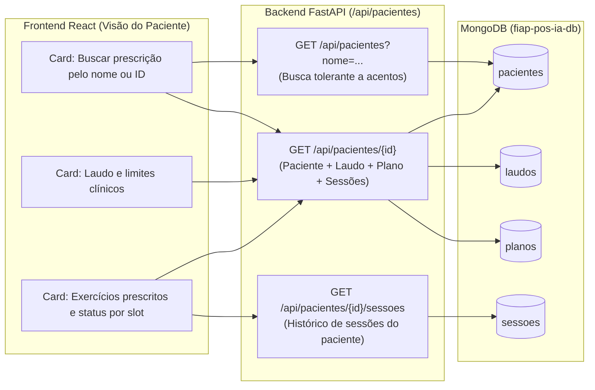

# Plano de Implementação — Issue #4: Busca de Dados de Laudo e Prescrições (`[Paciente]`)

> **Contexto:** Atendimento à Issue [#4](https://github.com/vagner-nascimento/fiap-pos-ia-para-devs-fase4-tech-challenge/issues/4) (*"[Paciente] Busca de dados de laudo e prescrições — Criação de estrutura frontend/backend para busca e apresentação de dados de prescrições e laudos por paciente"*), implementando o **Passo 2 da Jornada Principal** (`docs/jornada-proposta-001.md` e `docs/prd-fisio-coach-tech-challenge-fase4-v1_2.md`) e a **Tela 2 ("Minha prescrição")** do Design System oficial (`docs/design/DESIGN.md` e Mock `02-Paciente-Envio.dc.html`).

---

## 1. Visão Geral e Escopo

Na etapa anterior (**Issue #3**), construímos o módulo do **Fisioterapeuta/Médico** para cadastro de pacientes sintéticos (`PAC-001` a `PAC-004`), inserção do laudo com extração estruturada (`laudos`) e configuração do plano de exercícios (`planos`).

A **Issue #4** implementa a visão do **Paciente** (**Passo 2 da jornada**):
1. O paciente acessa a tela **"Minha prescrição"** e busca seu cadastro pelo **nome** (ex.: `"Marina T."`, `"Cláudia"`, `"Roberto"`) ou **código sintético** (ex.: `"PAC-001"`);
2. O sistema localiza o paciente e apresenta de forma clara e acessível:
   - **Card "Laudo e limites":** resumo diagnóstico do laudo médico, região anatômica, movimentos restritos, limite máximo de dor aceitável (`0–10`) e faixa de amplitude esperada (`graus`), além do selo de prescrição válida com dados fictícios (LGPD);
   - **Card "Exercícios prescritos / Sessões da prescrição":** listagem estruturada dos slots de exercícios prescritos no plano (`SLOT-1`, `SLOT-2`, ...), exibindo nome do exercício, equipamento necessário, lado avaliado, séries $\times$ repetições, instruções de execução e o **status atual de envio/execução** de cada exercício cruzado com as sessões já registradas pelo paciente (`● Enviada`, `Em processamento` ou `Pendente de envio`).

---

## 2. Decisões Arquiteturais e de Interface

> [!IMPORTANT]
> **Fronteira entre Issue #4 (Tela 2) e Issue #5 (Tela 3):**
> Conforme documentado em `docs/design/DESIGN.md`, as Telas 2 (*Minha prescrição*) e 3 (*Enviar sessões*) compartilham o mesmo artboard de referência (`02-Paciente-Envio.dc.html`).
> - **Nesta Issue #4:** implementamos a busca de prescrição por nome/código, a seleção quando houver múltiplos resultados, o card completo **"Laudo e limites"** e a listagem dos **slots de exercícios prescritos** com seus respectivos metadados clínicos e status (`● Enviada` quando já houver sessão para aquele exercício/slot, com atalho para ver o relatório, ou indicação de aguardo de envio).
> - **Na Issue #5 (próxima etapa):** acoplaremos a cada slot de exercício prescrito o seletor de vídeo/clipe, termo de consentimento LGPD e disparo de upload multipart por slot (`POST /api/sessoes`).

> [!TIP]
> **Busca Tolerante a Acentos (Diacríticos) e Atalhos de Demonstração:**
> Para garantir ótima usabilidade durante a demonstração em vídeo, a busca `GET /api/pacientes?nome=` ignora acentuação (ex.: digitar `"claudia"` encontra `"Cláudia M."`) e a tela exibe pílulas de acesso rápido para os 4 pacientes sintéticos do seed (`Marina T.`, `Roberto S.`, `Cláudia M.`, `Fernando L.`).

---

## 3. Mudanças Implementadas por Camada

### 3.1 Backend — Repositório e Endpoints REST (`backend/src/`)

- **`backend/src/infra/database/repositories/patient_repository.py`**:
  - `list_patients(nome_query)` com construção de expressão regular insensível a acentos e caixa alta/baixa em português (`_build_accent_insensitive_regex`).
- **`backend/src/models/rest/patient.py`**:
  - Inclusão de `sessoes_recentes: list[SessionDocument]` em `PatientClinicalBundleResponse`.
- **`backend/src/rest/routers/patients.py`**:
  - Novo endpoint `GET /api/pacientes/{paciente_id}/sessoes` para consulta do histórico de sessões do paciente (PRD v1.2 seção 6.3);
  - Enriquecimento de `GET /api/pacientes/{paciente_id}` com `sessoes_recentes`.

### 3.2 Frontend — Cliente REST e Visão do Paciente (`frontend/src/`)

- **`frontend/src/api/patients.js`**:
  - Adição das funções `getPatientMedicalReport`, `getPatientPlan` e `listPatientSessions`.
- **`frontend/src/components/PatientPrescriptionView.jsx`**:
  - Implementação da **Tela 2 ("Minha prescrição")** alinhada ao Mock `02-Paciente-Envio.dc.html` e ao Design System (`tokens.css`).
- **`frontend/src/App.jsx` e `frontend/src/styles.css`**:
  - Item de navegação **"Minha prescrição"** na Sidebar com alternância contextual do selo de perfil (`Paciente` / `Fisioterapeuta`) e estilos responsivos.

---

## 4. Plano de Verificação e Testes

1. **Testes Automatizados no Backend (`pytest`):** `backend/tests/unit/test_patients_plan_report_api.py` cobrindo busca insensível a acentos, busca sem resultados, consulta de laudo/plano e listagem de sessões por paciente.
2. **Build de Produção do Frontend (`npm run build`):** Validação de sintaxe, imports e bundle Vite.

