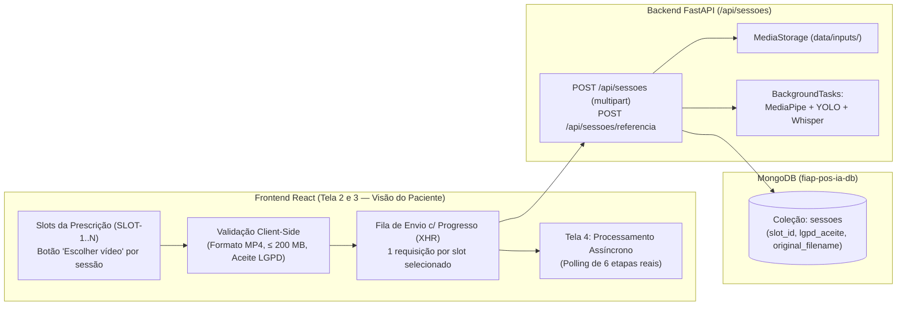

# Plano de Implementação — Issue #5: Upload de Vídeo de Seção de Exercícios (`[Paciente]`)

> **Contexto:** Atendimento à Issue [#5](https://github.com/vagner-nascimento/fiap-pos-ia-para-devs-fase4-tech-challenge/issues/5) (*"[Paciente] Upload de vídeo de seção de exercícios"*), implementando o **Passo 3 da Jornada Principal** (`docs/jornada-proposta-001.md` e `docs/prd-fisio-coach-tech-challenge-fase4-v1_2.md`) e a **Tela 3 ("Enviar sessões")** integrada à visão do paciente (`docs/design/DESIGN.md` e Mock `02-Paciente-Envio.dc.html`).

---

## 1. Visão Geral e Escopo

Nas etapas anteriores:
- **Issue #3:** construímos o módulo do **Fisioterapeuta/Médico** para cadastro de pacientes sintéticos (`PAC-001` a `PAC-004`), inserção do laudo médico (`laudos`) e configuração do plano de prescrição com slots de exercícios (`planos`).
- **Issue #4:** construímos a busca de prescrição pelo **Paciente** por nome ou código (sem expor outros pacientes por privacidade/LGPD), apresentando o card **"Laudo e limites"** e a lista de **slots de exercícios prescritos**.

A **Issue #5** implementa o **Passo 3 da jornada do paciente**:
1. **Seleção de vídeo por slot de exercício prescrito (`SLOT-1`, `SLOT-2`, ...):**
   - Cada slot de exercício prescrito exibe o botão **"Escolher vídeo"** (permitindo selecionar um arquivo `.mp4` gravado pelo paciente ou um clipe de demonstração compatível com o exercício);
   - Exibe o nome do arquivo selecionado e seu tamanho em MB (ex.: `sessao1.mp4 · 48,2 MB`), validando formato de vídeo e limite máximo de tamanho (`200 MB`, conforme seção 4 do `DESIGN.md` e seção 7 do PRD v1.2);
   - Permite remover/trocar o arquivo antes do envio ou enviar uma nova gravação para um slot que já possua sessão anterior.
2. **Termo de Consentimento LGPD (Imagem e Voz):**
   - Exibição e validação obrigatória do aceite do termo de consentimento LGPD para processamento de imagem (pose/equipamento) e voz (transcrição local de relato de dor) para fins exclusivos de apoio à decisão clínica.
3. **Envio de uma ou todas as sessões selecionadas (1 upload por sessão de fisioterapia):**
   - Botão principal **"Enviar para análise"** no rodapé do card (além da opção de envio individual por slot), realizando `POST /api/sessoes` (`multipart/form-data`) para cada slot com vídeo anexado;
   - Barra de progresso de upload em tempo real (`0%` a `100%`) e tratamento de erro por slot com opção **"Tentar novamente"** (`DESIGN.md` seção 4);
   - Ao concluir o envio, redireciona para a tela de acompanhamento do processamento (`ProcessingView.jsx`) ou apresenta links diretos para acompanhar cada sessão enviada quando múltiplos slots são enviados em lote.

---

## 2. Decisões Arquiteturais e de Design

> [!IMPORTANT]
> **Unificação das Telas 2 e 3 (`Minha prescrição` e `Enviar sessões`):**
> Conforme especificado em `docs/design/DESIGN.md` (Seção 3: *"Tela 2 e 3 estão na mesma página do mock; podem ser uma rota só (`/prescricao`) com seção de envio"*) e no Mock `02-Paciente-Envio.dc.html`, o card da direita opera como **"Enviar sessões"**, acoplando o seletor de arquivo e status diretamente a cada slot da prescrição do paciente.

> [!TIP]
> **Vinculação Exata por `slot_id` e Preservação no Pipeline Assíncrono:**
> Evoluímos `SessionDocument` e `MongoResultSink` para persistir e preservar `slot_id`, `lgpd_aceite`, `original_filename`, `file_size_bytes` e `created_at` do registro inicial criado no `POST /api/sessoes`. Assim, cada slot do plano (`SLOT-1`, `SLOT-2`, ...) mantém vínculo exato com sua sessão antes, durante e após o processamento.

---

## 3. Mudanças Propostas por Camada

### 3.1 Backend — Modelos, Sinks e Endpoints de Sessão (`backend/src/`)

- **`backend/src/models/database/session.py`**:
  - Adição dos campos opcionais `slot_id`, `lgpd_aceite`, `original_filename` e `file_size_bytes` em `SessionDocument`.
- **`backend/src/models/rest/session.py`**:
  - Inclusão de `slot_id` e `lgpd_aceite` em `CreateSessionPayload` e `CreateSessionResponse`.
- **`backend/src/rest/routers/sessions.py`**:
  - Suporte a `exercicio_id` e alias `exercicio` via `Form` em `POST /api/sessoes`;
  - Recebimento e validação de `slot_id`, `lgpd_aceite` (obrigatório `True`), extensão de vídeo válida e tamanho máximo (`200 MB`);
  - Persistência de metadados do arquivo e do slot no registro inicial da sessão.
- **`backend/src/services/pose/sinks.py`**:
  - Preservação de `slot_id`, `lgpd_aceite`, `original_filename`, `file_size_bytes` e `created_at` em `MongoResultSink.save`.

### 3.2 Frontend — Cliente de Upload com Progresso e Visão de Envio por Slot (`frontend/src/`)

- **`frontend/src/api/sessions.js`**:
  - Suporte a callback `onProgress(percent)` via `XMLHttpRequest` em `createSessionUpload`.
- **`frontend/src/components/PatientPrescriptionView.jsx`**:
  - Evolução do card direito para **"Enviar sessões"** conforme Mock `02-Paciente-Envio.dc.html`, com seletor de arquivo local (`.mp4`) ou clipe de demonstração por slot, validação de tamanho/formato, checkbox obrigatório de consentimento LGPD, progresso de upload por slot e botão **"Enviar para análise"**.
- **`frontend/src/styles.css`**:
  - Estilos para seleção de arquivo por slot, barra de progresso de upload, termo LGPD e responsividade mobile (`< 768px`).

---

## 4. Plano de Verificação e Testes

1. **Testes Automatizados no Backend (`pytest`):** Testes unitários e de integração cobrindo upload multipart com `slot_id` e `lgpd_aceite`, validação de recusa sem consentimento LGPD ou com formato inválido, e preservação de metadados no `MongoResultSink`.
2. **Build de Produção do Frontend (`npm run build`):** Validação de sintaxe, imports e bundle Vite.

