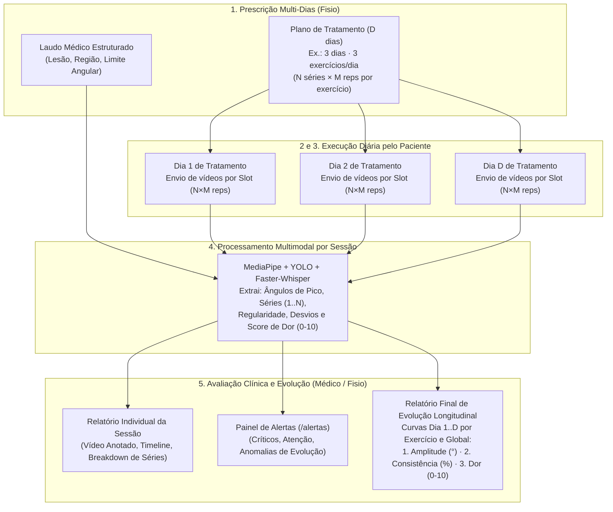

# Plano de Implementação — Issue #7: Jornada Multi-Dias, Relatório Final de Evolução e Painel de Alertas

> **Contexto:** Atendimento à **Issue #7** (*Relatório Final de Evolução do Paciente e Painel de Alertas*), considerando a jornada completa de reabilitação ao longo de **múltiplos dias de tratamento**, em que cada dia compreende a execução de **vários exercícios prescritos ($N$ séries $\times$ $M$ repetições/série por exercício)**, consolidando a evolução clínica em termos de **Amplitude**, **Consistência** e **Nível de Dor** ao longo das sessões.

---

## 1. Visão Geral da Jornada Multi-Dias e Arquitetura da Solução

Um tratamento fisioterapêutico real não se resume a um único vídeo isolado: o fisioterapeuta prescreve um **Plano de Tratamento** estruturado para **$D$ dias/sessões de tratamento**, contendo múltiplos **slots de exercícios** (`SLOT-1`, `SLOT-2`, ...), onde cada exercício exige **$N$ séries $\times$ $M$ repetições por série** em cada dia (meta diária de $N \times M$ repetições por exercício).

Ao final ou ao longo dos dias de tratamento, o **Médico / Fisioterapeuta** avalia tanto os alertas imediatos quanto o **Relatório Final de Evolução do Paciente**, que cruza todas as sessões executadas pelo paciente com o **Plano** e o **Laudo Médico** nas três dimensões clínicas centrais:
1. **Amplitude Articular (`graus`):** evolução do arco de movimento médio e máximo ($\bar{\theta}, \theta_{\max}$) ao longo dos dias e entre as séries de cada exercício, frente à faixa alvo do plano (`amplitude_esperada_min`–`max`) e ao teto seguro do laudo (`limite_amplitude_max`);
2. **Consistência Biomecânica (`0–100%`):** evolução da qualidade motora e aderência ao volume prescrito ($N$ séries $\times$ $M$ repetições), combinando a taxa de repetições válidas (sem compensações posturais) com a regularidade angular e temporal entre séries/repetições;
3. **Nível de Dor (`0–10` e `% do tempo`):** evolução da dor relatada/detectada por voz ao longo dos dias de tratamento frente ao limite máximo aceitável prescrito no plano (`dor_maxima_aceitavel`).

---

## 2. Modelagem Matemática e Clínica das Métricas de Evolução

Para garantir explicabilidade clínica (RNF de Explicabilidade e Ética do PRD v1.2), cada sessão concluída passa a consolidar e persistir indicadores padronizados que alimentam o **Relatório Final de Evolução**:

### 2.1 Segmentação em Séries ($N$ séries $\times$ $M$ repetições/série)
- Quando o paciente envia 1 vídeo consolidando o exercício do dia (com meta total $T = N \times M$ repetições), o backend agrupa as repetições detectadas em blocos sequenciais de tamanho $M$ (`series_breakdown`):
  - **Série $k$ ($k = 1 \dots N$):** contém as repetições de índice $(k-1)M + 1$ até $kM$, calculando para cada série: `repeticoes_completadas`, `repeticoes_validas`, `amplitude_media`, `amplitude_maxima` e `desvios_count`.
- Caso o paciente envie múltiplos vídeos para o mesmo slot no mesmo `dia_tratamento` (ex.: 1 vídeo por série), o agregador diário do Relatório de Evolução combina as execuções daquele slot no Dia $d$ para compor as $N$ séries do dia.

### 2.2 Amplitude Articular ($\theta$)
- **Por Sessão:**
  - $\bar{\theta}_{\text{sessão}} = \frac{1}{R} \sum_{i=1}^{R} \theta_{\text{pico}, i}$ (média dos ângulos de pico `peak_angle` das repetições detectadas, em graus);
  - $\theta_{\max, \text{sessão}} = \max_{i} (\theta_{\text{pico}, i})$ (amplitude máxima atingida na sessão).
- **Evolução Longitudinal ($\Delta \theta$):**
  - Compara $\bar{\theta}$ do Dia 1 ao último dia executado ($\Delta \theta = \bar{\theta}_{\text{atual}} - \bar{\theta}_{\text{inicial}}$);
  - Confronta com a faixa alvo do plano (`amplitude_esperada_min` a `amplitude_esperada_max`) e alerta caso ultrapasse `limite_amplitude_max` do laudo ou apresente regressão $\ge 10^\circ$ entre sessões consecutivas.

### 2.3 Consistência Biomecânica ($C \in [0, 100\%]$)
Avalia a estabilidade motora do paciente e sua aderência às $N$ séries $\times$ $M$ repetições:
$$C = 0{,}50 \cdot \text{TaxaVálidas} + 0{,}30 \cdot \text{RegularidadeAngularETemporal} + 0{,}20 \cdot \text{AderênciaVolume}$$
Onde:
- $\text{TaxaVálidas} = \frac{\text{valid\_repetitions}}{\max(1, \text{completed\_repetitions})} \times 100$ (execução livre de compensações posturais);
- $\text{RegularidadeAngularETemporal} = \max\left(0, 100 \times \left(1 - \frac{CV_{\theta} + CV_{d}}{2}\right)\right)$, sendo $CV_{\theta} = \frac{\sigma_{\theta}}{\mu_{\theta}}$ o coeficiente de variação dos ângulos de pico e $CV_{d} = \frac{\sigma_{d}}{\mu_{d}}$ o coeficiente de variação da duração das repetições ao longo das séries;
- $\text{AderênciaVolume} = \min\left(100, \frac{\text{completed\_repetitions}}{N \times M} \times 100\right)$ (cumprimento da meta de séries $\times$ repetições do dia).

### 2.4 Nível de Dor Consolidado ($\text{Dor}_{0\text{–}10} \in [0, 10]$)
- Mapeia os eventos de `fala_dor` e o percentual de tempo com dor para a mesma escala `0–10` utilizada no limite do plano (`dor_maxima_aceitavel`):
  - Se houver menção numérica explícita na fala (ex.: *"dor 6 de 10"*), extrai a nota relatada;
  - Caso contrário, converte o nível semântico (`pouca_ou_nenhuma_dor` $= 0$, `desconforto` $= 3{,}0$, `dor` $= 6{,}0$, `muita_dor` $= 8{,}5$) ajustado pela densidade temporal de dor no vídeo ($\text{percentual\_com\_dor}$).
- **Evolução Longitudinal ($\Delta \text{Dor}$):**
  - Avalia a tendência de redução da dor do Dia 1 ao Dia $D$ ($\Delta \text{Dor} = \text{Dor}_{\text{atual}} - \text{Dor}_{\text{inicial}}$) e destaca qualquer sessão em que $\text{Dor}_{0\text{–}10} > \text{dor\_maxima\_aceitavel}$.

---

## 3. Mudanças Propostas por Camada

### 3.1 Backend — Modelos de Dados (`backend/src/models/`)

1. **`backend/src/models/database/plan.py`**:
   - Adicionar `dias_tratamento: int = Field(default=3, ge=1, le=30, description="Quantidade de dias de tratamento previstos no plano")` em `PlanDocument`.
2. **`backend/src/models/database/session.py`**:
   - Adicionar em `SessionDocument`:
     - `dia_tratamento: int = Field(default=1, ge=1, description="Dia de tratamento no plano (1..D)")`
     - `series_prescritas: int = Field(default=1, ge=1)`
     - `repeticoes_por_serie: int = Field(default=5, ge=1)`
     - `serie_index: Optional[int] = Field(default=None)`
     - `amplitude_maxima: Optional[float] = Field(default=None)`
     - `amplitude_media: Optional[float] = Field(default=None)`
     - `consistencia_score: Optional[float] = Field(default=None)`
     - `dor_score_0_10: float = Field(default=0.0)`
     - `dor_percentual_tempo: float = Field(default=0.0)`
     - `series_breakdown: list[dict[str, Any]] = Field(default_factory=list)`
     - `avaliado_fisioterapeuta: bool = Field(default=False)`
3. **Novo arquivo `backend/src/models/database/alert.py`**:
   - Criar `AlertSeverity` (`critico`, `atencao`, `verde`), `AlertStatus` (`novo`, `lido`, `tratado`) e `AlertDocument` para a coleção `alertas` do MongoDB.
4. **`backend/src/models/rest/patient.py` e `backend/src/models/rest/session.py`**:
   - Incluir `dias_tratamento` em `SavePlanRequest`;
   - Incluir `dia_tratamento`, `series_prescritas`, `repeticoes_por_serie` e `serie_index` em `CreateSessionPayload`, `CreateSessionResponse` e `SessionReportResponse`;
   - Criar modelos de resposta do Relatório Final de Evolução (`PatientEvolutionReportResponse`, `DayEvolutionSummary`, `ExerciseEvolutionSeries`, `ExerciseSessionPoint`, `EvolutionGlobalMetrics`).

---

### 3.2 Backend — Serviços, Sinks, Repositórios e Seed Multi-Dias (`backend/src/`)

1. **Novo serviço `backend/src/services/evolution_service.py`**:
   - Funções puras para calcular `amplitude_media`, `amplitude_maxima`, `consistencia_score`, `dor_score_0_10` e `series_breakdown` ($N$ séries $\times$ $M$ repetições);
   - Construção do `PatientEvolutionReportResponse` agregando as sessões concluídas do paciente por **Dia de Tratamento (`Dia 1` .. `Dia D`)** e por **Slot/Exercício Prescrito**, calculando deltas ($\Delta \text{Amplitude}$, $\Delta \text{Consistência}$, $\Delta \text{Dor}$), tendências (`melhora`, `estavel`, `piora`) e o **Parecer Clínico Explicável** final.
2. **Novo repositório `backend/src/infra/database/repositories/alert_repository.py`**:
   - CRUD da coleção `alertas`: `save_alert`, `list_alerts`, `update_alert_status`, `mark_session_alerts_treated`, `mark_patient_alerts_treated`.
3. **`backend/src/services/pose/sinks.py`**:
   - Em `MongoResultSink.save`, calcular e persistir `amplitude_maxima`, `amplitude_media`, `consistencia_score`, `dor_score_0_10`, `dor_percentual_tempo` e `series_breakdown`, preservando `dia_tratamento`, `series_prescritas` e `repeticoes_por_serie`, e gerando alertas automáticos na coleção `alertas`.
4. **Seed Evolutivo Multi-Dias em `backend/src/rest/routers/patients.py`**:
   - Configurar `dias_tratamento=3` nos planos e popular sessões sintéticas multi-dias (**Dia 1, Dia 2 e Dia 3**) para **`PAC-001` (Marina T.)** e **`PAC-002` (Roberto S.)**, além de alertas iniciais na coleção `alertas`.

---

### 3.3 Backend — Endpoints REST (`backend/src/rest/routers/`)

| Método e Rota | Descrição |
|---|---|
| `GET /api/pacientes/{paciente_id}/relatorio-evolucao` | Retorna o Relatório Final de Evolução do paciente ao longo dos dias e exercícios do plano. |
| `POST /api/pacientes/{paciente_id}/avaliar-evolucao` | Registra a avaliação do Médico/Fisioterapeuta sobre o relatório evolutivo do paciente e marca alertas pendentes do paciente como `tratado`. |
| `GET /api/alertas` | Lista alertas clínicos para o Painel de Alertas (suporta filtros `?paciente_id=`, `?severidade=`, `?estado=`) e retorna contadores por severidade/estado. |
| `PATCH /api/alertas/{alerta_id}` | Atualiza o estado de um alerta (`novo`, `lido`, `tratado`). |
| `PATCH /api/sessoes/{session_id}/avaliar` | Marca uma sessão específica como avaliada pelo fisioterapeuta (`avaliado_fisioterapeuta=True`) e atualiza o alerta vinculado para `tratado`. |

---

### 3.4 Frontend — Telas e Componentes (`frontend/src/`)

1. **Clientes de API (`patients.js`, `sessions.js`, `alerts.js`)**: Consumo dos novos endpoints de evolução e alertas.
2. **Tela 1 (`PlanAndReportView.jsx`)**: Configuração de `dias_tratamento`, resumo de volume diário (`N×M reps/dia`) e atalho para a Evolução do Paciente.
3. **Telas 2 e 3 (`PatientPrescriptionView.jsx`)**: Seletor de **Dia do Tratamento (`Dia 1..D`)**, envio com `dia_tratamento`, `series_prescritas` e `repeticoes_por_serie`, e acesso ao Relatório de Evolução.
4. **Tela 5 (`SessionReportView.jsx`)**: Identificação do Dia de Tratamento, tabela de **Desempenho por Série (`Série 1..N`)**, integração do botão **"Marcar como avaliado"** e link para a Evolução Completa.
5. **Nova Tela 7 (`PatientEvolutionReportView.jsx`)**: Relatório Final de Evolução do Paciente com KPIs, gráficos SVG de evolução longitudinal (Amplitude, Consistência e Dor), matriz comparativa por exercício/dia e parecer clínico.
6. **Nova Tela 6 (`AlertsPanelView.jsx`)**: Painel de Alertas do Fisioterapeuta conforme Mock `05-Painel-Alertas.dc.html`.
7. **Navegação (`App.jsx`)**: Inclusão de **"Evolução do paciente"** e **"Painel de alertas"** na Sidebar.

